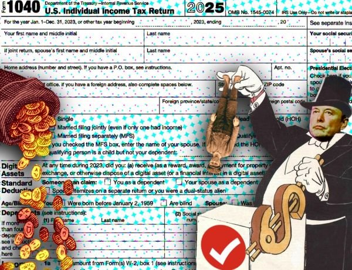
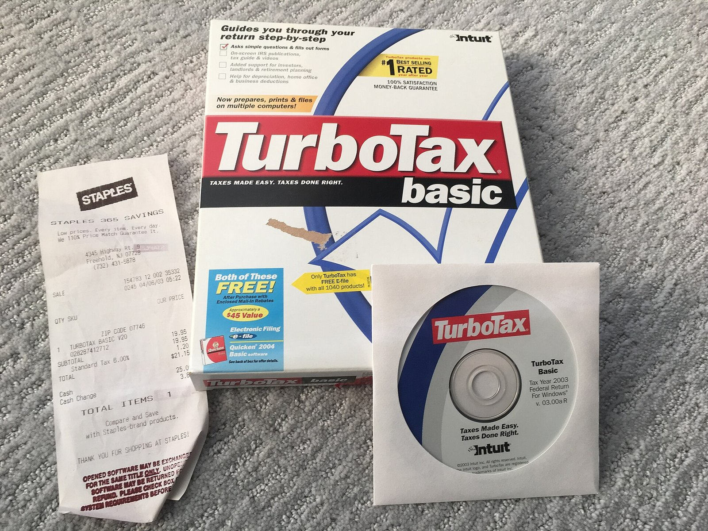

# TurboTax

*TurboTax box art and branding over the years — image by gruntzooki, CC BY-SA.*

TurboTax is Intuit's consumer tax-preparation software for the United States. It has been around, in one form or another, since the mid-1980s, when it shipped as a DOS program called MacInTax before being renamed and ported to Windows. Today it is the most widely used do-it-yourself tax product in the country, and for most people it is the first thing that comes up when they search for "turbotax."

This README is a plain-language orientation to the product: what it is, how the editions are split up, what people usually trip over, and where to go when you actually need to file.

## What TurboTax Actually Is

TurboTax is a guided interview. You answer questions about your income, deductions, credits, and life events, and the software fills in the corresponding tax forms in the background. The core value is not the math — the math is straightforward — but the mapping from plain-English questions to the correct lines on the right schedules. That mapping is where most people make mistakes when they file by hand.

The product is sold as a set of tiers, not one single program. The tier you need depends mostly on the kinds of income you have and whether you itemize:

- **TurboTax Free Edition** — for simple returns: W-2 wage income, a bit of interest, and the standard deduction. No state return included.
- **Deluxe** — adds itemized deductions (mortgage interest, charitable contributions, property tax) and is the tier most homeowners land on.
- **Premier** — adds investment income: capital gains, dividends, rental property, and some partnership items.
- **Self-Employed** — for freelancers, contractors, and small-business owners. Includes and the home-office and vehicle-expense helpers.

The naming changes slightly from year to year, but the split has been stable for a long time. If you are not sure which tier you need, Intuit's own "which product" quiz is usually accurate enough, and the pricing difference between Deluxe and Premier is small.

## The 2003 Box-Era Snapshot

*TurboTax Basic 2003 box with the install disc and a store receipt — photo by Jonathan Schilling, Wikimedia Commons.*

That photo is a useful time capsule. In the early 2000s, TurboTax shipped as a physical box with a CD-ROM and a paper receipt from a retail store. You installed it, entered your data, and printed the return or mailed it in. There was no cloud, no auto-save, and no connection to your bank.

The product has since moved almost entirely online. The current mainstream version is web-based and saves your progress as you go. The desktop download edition still exists and is preferred by a minority of users who want offline work or who have very complex returns, but the default experience is the browser.

## Common Gotchas

These are the things that surprise people every year, regardless of edition:

- **The "free" tier is narrower than it sounds.** The Free Edition genuinely is free, but it only covers a specific set of forms. If you have a 1099 for contract work, a rental property, or most investment income, the software will nudge you into a paid tier. That is by design, not a bug.
- **State returns are always extra.** Every paid federal tier still charges separately for the state return. Budget for that.
- **The interview is long.** Plan for 1–3 hours for a straightforward return, more if you own a business or have rental income. You can leave and come back, and it saves your place.
- **Import from last year works well — if you used TurboTax last year.** You can import your prior-year return data, which saves a lot of typing. If you used a different product last year, you will be entering everything fresh.
- **The "maximum refund" language is marketing.** The software cannot guarantee a maximum refund; it can only check that the forms it fills are internally consistent. What it does well is catch missing deductions you might not think to claim — that is the real value.

## Where the Confusion Comes From

A lot of people search for "turbotax" and land on something that is not exactly TurboTax. There are a few reasons:

- **TurboTax vs. TurboTax Live.** The regular product is fully do-it-yourself. TurboTax Live adds a human reviewer (or, at the higher tiers, a full prep session with a CPA or enrolled agent). The pricing is meaningfully higher and the experience is different. If you want a human to look at your return before you submit, that is the Live tier.
- **TurboTax vs. Intuit.** Intuit is the parent company. It also makes QuickBooks (accounting for small business) and Mint (now folded into Credit Karma). If you are looking for bookkeeping, you want QuickBooks, not TurboTax.
- **TurboTax vs. other DIY products.** The main competitors are H&R Block's software, TaxAct, and the IRS (which has income limits). For most simple returns, any of them will produce the same result. TurboTax's advantage is the polish of the interview and the depth of the help content; its disadvantage is the price, especially once you add state and a paid tier.

## The Bottom Line

TurboTax is a mature, well-supported product that will get the job done for the vast majority of filers. It is not the cheapest option, and the pricing structure rewards you for knowing exactly what your return involves before you start. If you have a simple W-2 return, the free tier is fine. If you have a business, a rental, or significant investments, expect to pay for the appropriate tier plus the state return.

The software is updated every year to reflect the latest tax law, and the interview questions are generally clear even for first-time filers. If you get stuck, the in-product help and the community forums are genuinely useful — more so than calling the support line, which has long wait times during peak season.

For most people, the honest summary is: TurboTax is the easiest way to file your own taxes, and you will pay a premium for that ease. Whether that premium is worth it depends entirely on how complicated your return is.

---

*Images: cover photo by gruntzooki (CC BY-SA); box photo by Jonathan Schilling (Wikimedia Commons). Both are part of this repository's assets folder.*

---
Photos: gruntzooki · CC BY-SA by-sa; Jonathan Schilling · Wikimedia Commons commons